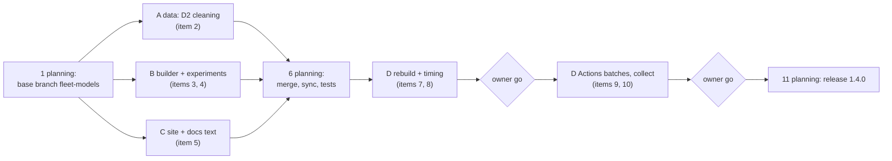

# Plan: two server models (R840 + C6320)

**Status (2026-10-29):** items 1–8 done; items 9–10 done for 6 servers (Actions run 40693621559: 39 runs, 20 finished, 19 stuck at a tick, kept as valid results; committed locally, 33b68b7). 10 servers, light and normal day (Actions runs 40754754068, 40754820788, 40754837540, 40754856946): 26 runs, 11 finished, 12 stuck, 3 crashed (HiGHS segfault on the Linux runner, repeated on resume; same tick solves on macOS; no result kept). The 10-server heavy day is not run in this release. Release 1.4.0 published from these results. Implements
[ADR 0001](adr/0001-server-fleet-from-processor-specs.md); the ADR holds the why, this file
holds the work. Where they differ, this file wins for the work and the ADR for the reasons.

---

## 1. Goal

Rebuild the 6- and 10-server fleets as in the thesis group's 2026-10-28 guide: R840 servers
at 2.1 and 2.4 GHz (CRAC), C6320 servers at 2.6 GHz (CRAC + cold plate). Frequencies come from
SPEC results for those models; power, temperature, cores and memory come from each model's
own UniMelb dataset (D1 = R840, D2 = C6320). Then rebuild the 12 scenarios and `small`, and
re-run the 78 per-tick runs as release 1.4.0.

## 2. Decisions (all final)

| # | Decision | By |
|---|---|---|
| D1 | Fleet tables as in the guide; 10-server split 3 / 4 / 3; zones alternate 1, 2, … | group |
| D2 | Tiers 2.1 / 2.4 / 2.6 GHz; the 2.6 GHz C6320s carry the cold plates and are also CRAC-cooled | group |
| D3 | Frequencies are assumptions taken from SPEC results: 2.1 GHz Xeon Gold 6130, 2.4 GHz Xeon Gold 6148 (R840, SPEC CPU2017 2018 Q2), 2.6 GHz Xeon E5-2690 v4 (C6320, SPEC CPU2006 2017 Q3) | group |
| D4 | Hosts drawn by seed from the eligible hosts of the row's model, without regard to power | owner |
| D5 | C6320 power, CPU temperature and memory from D2; `qh2-rcc263` and `qh2-rcc264` (258 GB, 48/96 slots) left out | owner |
| D6 | **Cores: R840 64, C6320 80**: the dataset's counts before the cloud doubled its vCPU slots in March 2019 (today's R840 rule) | group, Q1 = A |
| D7 | **C6320 memory 193 GB**, measured (`Ram` 193.33375 GB = 197,974 MB, by the same rule that gives the R840 66,036 MB) | group, Q2 = A |
| D8 | **C6320 inlet = the R840 room's measured inlet at the same timestamp**: per 10-min record, the mean over D1 hosts with a valid inlet (the 4.0 °C failed-sensor value excluded). Over D2's period it averages 18.8 °C, SD 0.6. Stated in the thesis as an assumption | group, Q3 = A |
| D9 | The light / normal / heavy rule (30 / 60 / 85 % of cores or memory, first to fill) stays; days grow with the fleet | owner |
| D10 | First Actions batch: 6 servers; the 10-server batch after its results are checked | owner |
| D11 | D2 eligibility gates: the R840 settings (`min_completeness` 0.90 over D2's own period, `min_peak_load` 30, `min_power_load_corr` 0.80, `min_idle_rows` 30, valid thermal fit with the D8 inlet). Fewer than 3 eligible C6320s: thread A stops and asks | planning |

What the thesis text must state as assumptions: D3 (frequency), D6 (cores = hardware threads
before the doubling), D8 (C6320 inlet borrowed from the R840 room).

## 3. Shared contract

Fixed before the threads start, so they can work at the same time without waiting on each
other. A thread that needs to change it asks the planning thread first.

**Raw data.** `data/raw/UniMelb_C6320.csv` = Zenodo 10069402 `dataset2_combined.csv`
(184,178,675 bytes, MD5 `8660d51cfb62dfc15f65c79406cb715f`). Columns: `Series, Time,
CPU_Load, CPU1_Temperature, CPU2_Temperature, Ram, Ram_Used, CPU_cores, CPU_cores_used,
Power, Network_RX, Network_TX, No_Of_Running_vms` (no inlet, no fans). `data/raw/` is
gitignored, so each worktree symlinks `data/raw` to the main checkout's.

**`data/clean/servers.csv`** (written by `data_prep.ipynb`): today's columns, plus

| Column | Values |
|---|---|
| `model` | `R840` (D1 hosts `qh2-rcc120`…`200`) or `C6320` (D2 hosts `qh2-rcc201`…`264`) |
| `inlet_source` | `measured` (R840) or `d1_room_mean` (C6320) |

C6320 rows: `N_cores` = `C_s_cores` = 80, `M_s_MB` = 197,974 (median of each host's `Ram`,
× 1024), `mean_inlet_C` from the D8 series. Host names never overlap. `rcc263`/`rcc264` stay
in the table with `eligible = 0`.

**Scenario settings** (`data_prep.ipynb` settings cell, `params.json` `settings`):
`freq_mhz` and `freq_split` are replaced by

```json
"fleet": [
  {"model": "R840",  "f_MHz": 2100, "zone": 1, "cold_plate": 0},
  {"model": "R840",  "f_MHz": 2100, "zone": 2, "cold_plate": 0},
  ...
  {"model": "C6320", "f_MHz": 2600, "zone": 2, "cold_plate": 1}
]
```

one row per server, in server order; `n_servers` and `n_zones` are derived from it.

| Scenario family | Fleet rows |
|---|---|
| `servers6*` | R840 2.1 z1, R840 2.1 z2, R840 2.4 z1, R840 2.4 z2, C6320 2.6 z1, C6320 2.6 z2 |
| `servers10*` | R840 2.1 z1, z2, z1; R840 2.4 z2, z1, z2, z1; C6320 2.6 z2, z1, z2 |
| `small` | R840 2.1 z1, R840 2.4 z2, C6320 2.6 z1 |

**Processor per tier** (`cpu` column): 2100 → `Xeon Gold 6130`, 2400 → `Xeon Gold 6148`,
2600 → `Xeon E5-2690 v4`.

**Scenario `servers.csv`:** today's columns, plus `model` and `cpu` after `server`.
`CT_s_cold_plate` and `n_cold_plates` come from the fleet row. `scheduler/io.py` reads by
column name, so the extra columns need no reader change.

**`scheduler/experiments.py`:** `TIERS = {"slow": 2100, "mid": 2400, "fast": 2600}`,
`COLD_PLATE_TIER = "fast"`; servers10 tiers 3 slow / 4 mid / 3 fast; servers10 regroup map
`(1, 1, 1, 2, 2, 2, 2, 2, 2, 2)` (slow tier in zone 1, as today); servers6 unchanged.

**Version:** 1.4.0 at release. The 1.3.0 results stay on the site until then.

## 4. Work items

| # | Item | Thread |
|---|---|---|
| 1 | Put D2 in `data/raw/`; branch `fleet-models` off `refactor-10_25`; commit the ADR and this plan | planning |
| 2 | `data_prep.ipynb`: read D2; same cleaning as D1 minus inlet and fans; build the D8 inlet series from D1; power fit, gates (D11) and thermal fit on it; `model`, `inlet_source` columns; drop `rcc263`/`264`; settings cell to the `fleet` shape; `data/raw/README.md`; `DATA_PREP_REPORT.md` (two datasets, decisions 7–8 rewritten, server tables, the missing-inlet finding) | A |
| 3 | `scheduler/build.py`: `pick_servers` from the fleet table with a seeded draw per model, no host twice in a fleet; `check_settings` for the new shape; `derive_scenario` and `build_running_variant` on it; diagnostics without `freq_mhz` (`peak_load_share_of_fastest_tier` from the fleet rows); `assumed_not_from_data` lists D3, D6, D8 | B |
| 4 | `scheduler/experiments.py` per the contract; `tests/test_build.py`, `tests/test_experiments.py` on a small fixture `servers.csv` with both models | B |
| 5 | Site and docs text: no hard-coded "3000 MHz" (read `TIERS`), model names in captions and server tables (`dashboard/`), `README.md`, `dashboard/README.md`, `scheduler/README.md`, markdown cells of `solver.ipynb` and `batch.ipynb` | C |
| 6 | Merge A, B, C into `fleet-models`; `tools/sync_notebooks.py`; full `uv run pytest` | planning |
| 7 | Run `data_prep.ipynb`; rebuild the 12 scenarios + `small`; check diagnostics against the ADR's estimates (about 1.6× workloads, memory still first to fill, repeats on the 10-server days) and report differences | D |
| 8 | Time one `servers6_heavy` base run locally at the 60 s cap; report wall time and ticks at the cap | D |
| 9 | 1.4.0 run list; push `per-tick-runs`; dispatch the 6-server batch | D, **needs the owner's go** |
| 10 | Collect the 6-server results, check every run, commit locally; then the 10-server batch the same way (**go** again) | D |
| 11 | Release 1.4.0: version, changelog, site, notebooks to the group | planning, **needs the owner's go** |

## 5. Threads



| Thread | Items | Branch / worktree | Owns (only it edits) | Runs alongside |
|---|---|---|---|---|
| A: C6320 data | 2 | `fleet-a-data`, own worktree off `fleet-models` | `notebooks/data_prep.ipynb` (not its copied `build.py` cells), `data/clean/`, `data/raw/README.md`, `docs/DATA_PREP_REPORT.md` | B, C |
| B: builder | 3, 4 | `fleet-b-builder`, own worktree | `scheduler/build.py`, `scheduler/experiments.py`, `tests/test_build.py`, `tests/test_experiments.py`, test fixtures | A, C |
| C: text | 5 | `fleet-c-text`, own worktree | `dashboard/`, `README.md`, `dashboard/README.md`, `scheduler/README.md`, markdown cells of `solver.ipynb` and `batch.ipynb`, site tests | A, B |
| D: rebuild + runs | 7–10 | `fleet-models`, after the merge | `scenarios/`, `results/`, `logs/runs/v1.4.0/` | none |
| planning (this thread) | 1, 6, 11 | `fleet-models` | this file, the ADR, merges, `tools/sync_notebooks.py` runs | all |

Overlap rules:

- `build.py` is copied into the notebooks. Only the planning thread runs
  `tools/sync_notebooks.py`, at the merge. A and C do not edit the copied code cells.
- A writes `data/clean/servers.csv` for real; B tests against its own fixture, so B does not
  wait for A.
- C reads tier names and frequencies from `scheduler/experiments.py` as the contract gives
  them; it does not edit that file.
- The notebooks stay standalone: no references to repo files, tools, docs or the CLI.
- No student names and no thesis PDF text in tracked files (the repo is public).
- Each thread runs `uv run pytest` before handing back. Failures in files another thread owns
  are reported, not fixed.

Each thread ends by reporting commits, tests, and anything in the contract it could not
follow. No thread pushes, dispatches Actions or releases.

### Thread briefs

Each thread gets this file plus its brief.

- **A.** "Implement item 2 of `docs/PLAN_FLEET_MODELS.md` on branch `fleet-a-data`. Symlink
  `data/raw` to the main checkout's. Follow §2 and §3 exactly. Re-run the notebook end to end,
  commit the notebook with outputs and `data/clean/`. Report: eligible C6320 hosts and which
  gates the others failed; C6320 P_idle, P_max, thermal fit RMSE against the R840s'."
- **B.** "Implement items 3 and 4 of `docs/PLAN_FLEET_MODELS.md` on branch `fleet-b-builder`.
  Follow §3 exactly; do not run `tools/sync_notebooks.py` and do not touch notebooks or
  `data/clean/`. Report: the new settings shape, how the seeded draw works, tests added."
- **C.** "Implement item 5 of `docs/PLAN_FLEET_MODELS.md` on branch `fleet-c-text`. Text and
  captions only; read tiers from `scheduler/experiments.py` as §3 gives them. Report every
  file and caption changed."
- **D** (after the merge). "Implement items 7 and 8 of `docs/PLAN_FLEET_MODELS.md` on
  `fleet-models`. Do not push or dispatch. Report the diagnostics table and the timing run."

## 6. Launch steps

1. `cp /tmp/zenodo_d2/dataset2_combined.csv data/raw/UniMelb_C6320.csv` in the main checkout;
   check the MD5.
2. Branch `fleet-models` off `refactor-10_25`; commit the ADR, this file and the group
   questions. Worktree threads start from that commit (uncommitted edits are not copied).
3. Launch A, B, C as T3 threads, each in its own worktree off `fleet-models`, with its brief.
4. When all three report: merge (item 6), then launch D.

## 7. Expected effort and run time

- A: half a day to a day (new dataset, no inlet). B: half a day. C: a few hours.
- Rebuild: about a minute for `data_prep.ipynb`, then the scenario builds.
- Runs: about 1.6× the workloads (D7). Expect the 6-server batch to take longer than its 1.3.0
  time of about 1.5 h, and the 10-server heavy day to hit the 60 s cap more often than its 869
  ticks in 1.3.0. Item 8 measures this before anything is dispatched.

## 8. Decision log

| Date | Decision |
|---|---|
| 2026-10-28 | Guide received; ADR 0001 drafted |
| 2026-10-28 | Hosts re-picked by seeded draw; C6320 data from D2; ADR first, no code |
| 2026-10-28 | Plan proposed; threads A, B, C in parallel, D after the merge; 6 servers first |
| 2026-10-28 | Group answered A to all three questions: cores 64 / 80, C6320 memory 193 GB, C6320 inlet from the R840 room at the same timestamp. Plan final |
| 2026-10-28 | Inlet figures corrected: excluding the 4.0 °C failed-sensor value, the R840 room inlet over Feb–Jun 2019 is 18.8 °C mean, SD 0.6 (earlier 17.7 / 4.2 included those readings) |
| 2026-10-28 | `qh2-rcc248` excluded (rcc263's power and thermal profile with the C6320's memory); C6320 records above 160 slots dropped, like the R840's doubled records. 43 C6320s and 45 R840s eligible |
| 2026-10-28 | Owner: everything is per-tick; the whole-day solver is no longer needed (`small_running` test moved to per-tick) |
| 2026-10-28 | Rebuild: 6-server days now draw 91 / 257 / 370 workloads (the old 10-server counts; fleet memory is almost the same), 10-server days 199 / 414 / 604 with 0 / 77 / 267 repeats. Memory still fills first |
| 2026-10-28 | Timing run (local M4): servers6_heavy base **stuck at tick 110** (no schedule in 60 s; 61 waiting, 42 running); 93 ticks optimal, 16 at the cap with gaps up to 26 %. 1.3.0: done, 283 / 5, gap 0.2 %. The batch needs a decision first: higher cap, smaller heavy day, or solver work |
| 2026-10-28 | Stuck-tick diagnosis (tick 110 rebuilt from a checkpoint): a valid schedule exists (feasibility-only finds one in 138 s; full solve optimal, gap 0.1 %, in 490 s). Not a constraint conflict: 407 GB and 297 cores free, one C6320 empty, no waiting workload due within 6 ticks. Cause: 61 workloads held back for carbon make a 38,653-binary model (interior-point LPs above 30,000) and the warm start leaves the 7 new arrivals unplaced, so HiGHS needs > 60 s to find any schedule |
| 2026-10-29 | 6-server batch done: 20 finished, 19 stuck (18 on the 60 s tick cap, heavy 6.4 Test 1 with no valid schedule at tick 68). Owner: stuck runs are valid results, reported as they are, not re-run |
| 2026-10-29 | Owner: run the 10-server light and normal days; the 10-server heavy day is not run in 1.4.0. Release 1.4.0 prepared (thread E) |
| 2026-10-29 | Owner: cold plates must be on in every scenario (1.4.0 had them only in 6.2, so the C6320s were CRAC-only in the Base, 6.1, 6.3 and 6.4). `cold_plates` now defaults to on (`--no-cold-plates` to turn off); 6.2 uses the shared Base, `s2_base` dropped (36 runs per fleet). Each day's 1.4.0 `s2_base` is renamed `base`; 6.2 Tests 1-2 stand. Re-run on the owner's go: 6.1 Tests 1-2, 6.3, 6.4 on servers6 light/normal/heavy (27) and servers10 light/normal (18), plus servers10 6.2 Test 2 (crashed in 1.4.0): 46 runs |
