# ADR 0001: Two server models, R840 and C6320, with frequencies from processor specs

**Status:** Accepted, 2026-10-28. The work is in [`docs/PLAN_FLEET_MODELS.md`](../PLAN_FLEET_MODELS.md).
**Source:** the thesis group's edit guide of 2026-10-28 (kept locally, not in the repo).

## 1. Context

### What the group asks for

1. Set each server's frequency from the processor of a named server model, using the
   SPEC CPU result pages, instead of ranking the UniMelb hosts by power and handing the
   fastest tier to the most power-hungry ones.
2. The fleet becomes two server models:
   - Dell PowerEdge **R840** at **2.1 GHz** and **2.4 GHz**, cooled by CRAC air only;
   - Dell PowerEdge **C6320** at **2.6 GHz**, cooled by CRAC air **plus a cold plate**.
3. Check that each server's core count matches its processor, because Ch. IV computes a
   server's processing capability as cores × frequency. If they do not match, the thesis
   will say the frequency is an assumption taken from the literature.
4. Keep the UniMelb power data, but make sure it fits the server types.
5. Side question: how long does a run take? The adviser may ask for a metaheuristic if it is
   too slow.

The requested fleets:

| Fleet | Server | Model | Zone | Frequency | Cooling |
|---|---|---|---|---|---|
| 6 servers | 1, 2 | R840 | 1, 2 | 2.1 GHz | CRAC |
| | 3, 4 | R840 | 1, 2 | 2.4 GHz | CRAC |
| | 5, 6 | C6320 | 1, 2 | 2.6 GHz | CRAC + cold plate |
| 10 servers | 1–3 | R840 | 1, 2, 1 | 2.1 GHz | CRAC |
| | 4–7 | R840 | 2, 1, 2, 1 | 2.4 GHz | CRAC |
| | 8–10 | C6320 | 2, 1, 2 | 2.6 GHz | CRAC + cold plate |

### What the code does today (release 1.3.0 and `refactor-10_25`)

`scheduler/build.py::pick_servers` sorts the 45 eligible UniMelb hosts by dynamic power
(P_max − P_idle), takes evenly spaced ones, sorts those by P_max and gives the frequencies
in rising order: 2.1, 2.4, then **3.0 GHz**. The 3.0 GHz tier gets the cold plate
(`CT_s_cold_plate = f == top_f`). Every server is an R840 with 64 cores and 64 GB, because
the repo only uses the R840 part of the UniMelb data. The 10-server split is **4 / 3 / 3**;
the 6-server split is 2 / 2 / 2. Zones alternate 1, 2, 1, 2, …

### What the UniMelb dataset says (checked 2026-10-28)

The UniMelb data is the Zenodo record [10.5281/zenodo.10069402](https://zenodo.org/records/10069402)
(Ilager et al., UCC 2023, [paper](http://hpc.ec.tuwien.ac.at/files/UCC_23_data_center_analysis.pdf)).
It has **two** datasets. The repo uses only the first.

| | D1, `dataset1_combined.csv` (in the repo as `UniMelb.csv`) | D2, `dataset2_combined.csv` (not used yet) |
|---|---|---|
| Server model | Dell **R840** | Dell **C6320** |
| Hosts, period | 80, Oct 2018 – Jun 2019 | 64, Feb – Jun 2019 |
| CPUs per host | 2 (two CPU temperatures) | 2 (two CPU temperatures) |
| `CPU_cores` | 64, then 128 from mid-March 2019 | 160 on 62 hosts (80 in the first two hosts' first three days; 320 on some hosts from March 2019) |
| Memory | 64 GB | **193 GB** on 62 hosts (the paper says 196); 258 GB on 2 |
| Power | yes | yes |
| CPU temperature | yes | yes |
| Inlet temperature, fan speeds | yes | **no** |
| Processor model, frequency | not given | not given |

Checked on all 64 D2 hosts (1.28 million rows, 1 Feb – 20 Jun 2019):

- **62 hosts are alike** (160 slots, 193 GB, same power range). **2 hosts differ**
  (`qh2-rcc263`, `qh2-rcc264`: 48 then 96 slots, 258 GB, about 286 W idle and 374 W max).
  They are a different configuration and should be left out.
- Power follows each host's own CPU load closely (median correlation 0.96, 60 of 62 hosts
  at 0.80 or more, against 0.90 for D1), so it is a per-host reading, not a shared chassis
  reading.
- A C6320 draws far more than an R840: about **390 W idle** and a median peak of about
  **755 W** (up to 806 W) (R840: about 155 W idle, about 360 W max). A straight-line fit to
  100 % load gives a median of about 1,030 W, but the median host peaks at 53 % load, so that
  end is extrapolated. 52 of 62 hosts reach 40 % load.
- CPU temperatures peak at a median 77 °C (R840: 81 °C).

What this settles and what it does not:

- **C6320 power and temperature data exist in the same dataset.** Using D2 meets the guide's
  "UniMelb power data that matches the server types" directly; nothing has to be borrowed
  from an R840.
- **The dataset does not name the processors.** `CPU_cores` counts the cloud's vCPU
  slots, not physical cores: it doubled in both clusters in March 2019, and 160 is more than
  any two-socket C6320 can have (at most 2 × 22 cores, 88 threads). The two C6320 hosts seen
  from their first days start at **80** and go to 160 after about three days, which reads as 80
  hardware threads with the cloud then allowing two vCPUs per thread. The R840's 64 is
  likewise its threads before its own doubling. So the like-for-like count is **R840 64,
  C6320 80**. The paper does not settle it: its text gives 2 × 64 = 128 and 2 × 80 = 160 per
  host, its Table 1 gives 128 and 256. It cannot confirm a SPEC processor either way.
- **Why D2 has no inlet (checked 2026-10-28).** The paper only says fan speeds and inlet
  "are not available in D2". The raw files show a pattern: the 76 R840 hosts monitored since
  October 2018 report inlet and fans; the 5 R840 hosts `qh2-rcc196`–`200`, whose records
  start on **1 February 2019**, report neither, and neither do any of the 64 C6320 hosts,
  whose records also start on 1 February 2019. Those five are R840s (64 slots, 64.5 GB), the
  same model whose other hosts report inlet, so the gap follows when a host was added to the
  monitoring, not the hardware. Most likely the collection set up in February 2019 did not
  read those IPMI sensors. (The five are already ineligible: 26 % complete.) R840 inlet is in
  1 °C steps, and hosts in the same group of four (`120`–`123`, `124`–`127`, …) read the
  same value about 60 % of the time, so it tracks the air of their part of the room.
- **D2 has no inlet temperature.** The R840 thermal fit
  (T_cpu = T_inlet + a + R · P, with lag alpha) uses the inlet. For the C6320 the inlet has
  to come from somewhere else (§6).

### What the SPEC pages say

| Model | Processor (SPEC result) | Nominal | Cores per chip | Cores per server | Memory on the SPEC system |
|---|---|---|---|---|---|
| R840 | Xeon Gold 6130 ([CPU2017 int rate](https://www.spec.org/cpu2017/results/res2018q2/cpu2017-20180514-05589.html)) | 2.1 GHz | 16 | 32 (2 chips, 64 threads) | 384 GB |
| R840 | Xeon Gold 6148 ([CPU2017 int rate](https://www.spec.org/cpu2017/results/res2018q2/cpu2017-20180514-05562.html)) | 2.4 GHz | 20 | 80 (4 chips) | 768 GB |
| C6320 | Xeon E5-2690 v4 ([CPU2006 int rate](https://www.spec.org/cpu2006/results/res2017q3/cpu2006-20170725-47889.html)) | 2.6 GHz | 14 | 28 (2 chips, 56 threads) | 256 GB |

- Both "exact location" links in the guide point to the same page, the **C6320** CPU2006
  result. No R840 page was pinned; the two R840 rows are the 2018 Q2 CPU2017 results that
  carry 2.1 and 2.4 GHz.
- The 2.1 GHz R840 (2 × Gold 6130, 64 threads) fits D1's 64 slots and two CPUs. The 2.4 GHz
  Gold 6148 and the 2.6 GHz E5-2690 v4 (56 threads against D2's 80) do not fit. Since the
  dataset names no processor, **the thesis states the frequencies as assumptions taken from
  SPEC results for these server models**, the guide's fallback.

## 2. Decision (proposed)

Replace the power-ranked frequency assignment with **an explicit fleet table per fleet**
(model, zone, frequency, cooling), as in the guide, and **take each model's measurements
from its own UniMelb dataset**: R840 rows from D1, C6320 rows from D2.

- Tiers become **2.1 / 2.4 / 2.6 GHz**. The 2.6 GHz C6320s carry the cold plates and are
  still cooled by the CRAC for the heat the plate does not remove (the model already does
  this: `Q_crac ≥ Σ (P_IT − Q_cp)`).
- The 10-server split becomes **3 / 4 / 3** (was 4 / 3 / 3). The 6-server split stays 2 / 2 / 2.
- **Hosts are re-picked by a seeded draw** from the eligible hosts of the right dataset,
  without regard to power (owner's decision, 2026-10-28).
- `servers.csv` gains `model` and `cpu` columns.
- Cores, memory and the C6320 inlet are set by the open decisions in §6.
- The scenarios are rebuilt and **all 78 per-tick runs are re-run** (39 per fleet). The
  published 1.3.0 numbers stay on the site until the new release.

## 3. What changes and what stays

```mermaid
flowchart LR
  subgraph CHANGE["Has to change"]
    direction TB
    C0["data_prep: read D2 (C6320) too;<br/>clean, gate and fit it"]
    C1["build.py pick_servers:<br/>power ranking → fleet table + seeded pick"]
    C2["Tiers 2.1 / 2.4 / 3.0 → 2.1 / 2.4 / 2.6 GHz"]
    C3["servers10 split 4/3/3 → 3/4/3<br/>and its 6.1 T1 regroup map"]
    C4["Cold plate: f == top_f → model == C6320"]
    C5["servers.csv: + model, cpu;<br/>C6320 cores, memory, power, thermal from D2"]
    C6["experiments.py TIERS, COLD_PLATE_TIER"]
    C7["12 scenarios rebuilt<br/>(6 and 10 servers × L/N/H × swing)"]
    C8["78 per-tick runs re-run"]
    C9["Text: READMEs, DATA_PREP_REPORT,<br/>site captions '3000 MHz', notebooks"]
    C10["Tests that pin tiers or splits"]
  end
  subgraph DECIDE["Decided (§6)"]
    direction TB
    D1["Cores: R840 64, C6320 80"]
    D2["C6320 memory: 193 GB"]
    D3["C6320 inlet: R840 room at same time"]
    D4["D2 gates: R840 settings"]
  end
  subgraph KEEP["Can keep"]
    direction TB
    K1["MILP formulation and HiGHS"]
    K2["Per-tick re-planning (2A),<br/>checkpoints, 60 s cap"]
    K3["GitHub Actions batch workflow"]
    K4["CRAC + cold-plate cooling model"]
    K5["Zones alternate 1, 2, … (matches guide)"]
    K6["6-server split 2/2/2, plates on 5–6"]
    K7["2.1 and 2.4 GHz tiers; f_ref = 2.4 GHz work unit"]
    K8["R840 cleaning, gates and fits (D1)"]
    K9["UFCG workloads, carbon curves,<br/>light/normal/heavy, tests 6.1–6.4"]
    K10["Baseline rule, evaluator, site and<br/>notebook structure"]
  end
  DECIDE --> CHANGE
```

### Has to change

| Area | Today | After |
|---|---|---|
| Raw data | `UniMelb.csv` = D1 only | D1 and D2; `data/raw/README.md` lists both |
| `notebooks/data_prep.ipynb` cleaning | R840 hosts only; thermal gate needs inlet | also C6320 hosts; `model` column in `data/clean/servers.csv`; a thermal fit that works without inlet |
| `scheduler/build.py::pick_servers` | ranks hosts by power, frequency follows P_max | reads a fleet table (model, zone, frequency, cooling) and draws hosts of that model by seed |
| Fast tier | 3.0 GHz R840 | 2.6 GHz C6320 |
| 10-server split | 4 slow / 3 mid / 3 fast | 3 / 4 / 3 |
| 6.1 Test 1 regroup map (10 servers) | (1,1,1,1,2,2,2,2,2,2): slow tier in zone 1 | (1,1,1,2,…): keeps "slow tier in zone 1" |
| Cold plate flag | `f == top_f` | model is C6320 |
| `servers.csv` | no model column, 64 cores and 64 GB everywhere | `model`, `cpu`; C6320 cores and memory per §6; `PC_s_MHz` = cores × f and `W_per_MHz` recomputed |
| `scheduler/experiments.py` | `TIERS["fast"] = 3000` | 2600; servers10 tiers 3/4/3 |
| `params.json` `assumed_not_from_data` | "f_s_MHz assignment" | frequencies from SPEC for the model; C6320 inlet if assumed |
| Scenarios | 12 built on 3.0 GHz R840s | rebuilt; the workload draw changes if C6320 cores or memory differ from 64 / 64 GB |
| Results | 78 runs, release 1.3.0 | re-run all 78, new release |
| Text | "2.1, 2.4 and 3.0 GHz", "3000 MHz" in README, dashboard README, site captions (`views/section.py`, `views/chapter6.py`), DATA_PREP_REPORT decisions 7–8 and server table, notebooks | 2.6 GHz, R840 / C6320, two datasets |
| Notebooks | carry a copy of `build.py` | resync with `tools/sync_notebooks.py` |
| Tests | `test_experiments`, `test_build`, site tests pin tiers and splits | updated |

### Can keep

- The MILP, the per-tick engine, checkpoint and resume, the Actions workflow, the 60 s cap.
- The cooling model: CRAC + cold plate is already how cold-plate servers are cooled.
- The zone layout: both tables alternate zones exactly as the builder does now.
- The 6-server fleet shape (2 / 2 / 2, plates on servers 5 and 6).
- The 2.1 and 2.4 GHz tiers and the work unit (one vCPU at 100 % = 2.4 GHz).
- The R840 cleaning, gates and fits from D1 (the hosts are re-picked, the method is the same).
- Workloads, carbon curves, load levels, the 6.1–6.4 test list, the baseline rule, the
  evaluator, the site and notebook structure.

## 4. Consequences

- **Every published number moves.** The cold-plate tier changes model, frequency (3.0 →
  2.6 GHz) and power data; the 10-server fleet trades a slow server for a mid one; the hosts
  are re-picked.
- **The cold-plate servers become the most power-hungry ones.** A C6320 idles at about
  400 W, two and a half times an R840. The model has no on/off variable, so idle power is a
  fixed cost in both baseline and optimized runs, but it raises total energy and the heat
  the cooling must remove. Today the fast tier is the efficient place to put work; with D2
  data it may not be, which can change what 6.2 (cold plates) shows.
- With 80 cores and 193 GB, two C6320s add more capacity than two R840s did, so the workload
  draw (a share of fleet cores or memory) grows and runs may get slower.

Estimated effect, C6320 at 80 cores and 193 GB, median hosts (before rebuilding):

| | 6 servers today | 6 after | 10 servers today | 10 after |
|---|---|---|---|---|
| Cores | 384 | 416 | 640 | 688 |
| Memory | 387 GB | 644 GB (+66 %) | 645 GB | 1,030 GB (+60 %) |
| Idle power | 894 W | ≈1,400 W (+57 %) | 1,557 W | ≈2,250 W (+45 %) |
| Workloads, normal day | 132 | ≈220 | 257 | ≈410 |

Memory decides the workload draw in every scenario today, so more memory means more
workloads. Keeping the C6320 at 64 GB keeps today's workload counts.

The light / normal / heavy days need no new rule: they are shares of the fleet (30 / 60 /
85 %), so they grow with it. The drawn workloads ask for 2.0 GB per vCPU; an R840 offers
1 GB per core and a C6320 2.4, so even after the change memory fills first at fleet level
(heavy day: about 86 % of memory against 67 % of cores). The catalogue has 339 workloads
within the length limits; past that the draw repeats them (same arrival times), which today
happens only on the 10-server heavy day (33 repeats). After the change, estimated:

| Day | 6 servers today → after | 10 servers today → after |
|---|---|---|
| Light | 45 → ≈75 | 91 → ≈145 |
| Normal | 132 → ≈220 | 257 → ≈410 (≈70 repeats) |
| Heavy | 210 → ≈350 (≈10 repeats) | 370 → ≈590 (≈250 repeats) |

Dynamic watts per GHz of work, (P_max − P_idle) / (cores × f), median host:
R840 2.1 GHz 1.53, 2.4 GHz 1.34, today's 3.0 GHz cold-plate tier 1.07 (the most efficient);
C6320 at 80 cores 1.76 (the least efficient), at 160 cores 0.88. The cores choice decides
which way the cold-plate tier looks.
- The thesis states which values come from SPEC (frequency), which from UniMelb (power,
  temperature, cores, memory) and which stay assumed (C6320 inlet, if so).

## 5. Run time (the group's side question)

Measured on the 78 per-tick runs of 1.3.0 (GitHub Actions, 4 cores, 60 s cap per tick, one
24 h day = 288 ticks):

| Fleet · day | Median run | Slowest run | Ticks that hit the cap |
|---|---|---|---|
| 6 servers · light | 4 min | 16 min | 1 |
| 6 servers · normal | 14 min | 34 min | 4 |
| 6 servers · heavy | 34 min | 82 min | 180 |
| 10 servers · light | 16 min | 61 min | 35 |
| 10 servers · normal | 54 min | 2.1 h | 322 |
| 10 servers · heavy | 2.3 h | 2.7 h | 869 |

The 39 runs of a fleet run in parallel, so a full fleet batch takes about as long as its
slowest run: about 1.5 h for 6 servers and about 3 h for 10. Two 10-server runs stayed stuck
at one tick even at 120 s. The 6-server fleet solves comfortably; the 10-server heavy day is
where the exact solver runs into its cap, and that is the case a metaheuristic would target.
The new fleet will be somewhat larger in work, so expect these times or a little more.

## 6. Decisions

Made (2026-10-28):

- Hosts are re-picked by a seeded draw, without regard to power.
- ADR only for now; no code until the open decisions are settled.
- C6320 power comes from D2 rather than borrowed or scaled R840 data (the owner asked to
  check the dataset first; D2 has it).

Made by the thesis group (2026-10-28, option A on all three questions):

- **Cores:** R840 64, C6320 80, the dataset's counts before the March 2019 doubling.
- **C6320 memory:** 193 GB, measured.
- **C6320 inlet:** the R840 room's measured inlet at the same timestamp (mean over D1 hosts
  with a valid reading, the 4.0 °C failed-sensor value excluded): 18.8 °C mean, SD 0.6 over
  February–June 2019. Stated in the thesis as an assumption.
- **Run order:** 6 servers first (owner).
- **D2 eligibility gates:** the R840 settings, with the borrowed inlet for the thermal fit.
